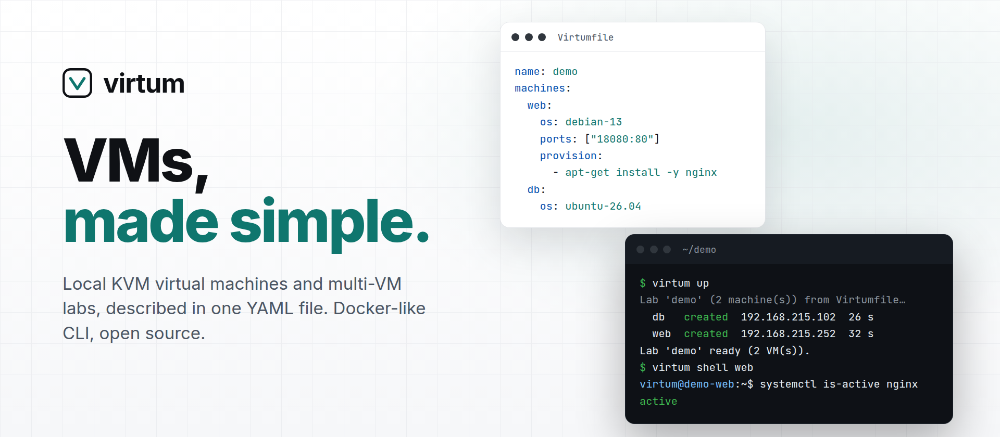

<p align="center">
  <picture>
    <source media="(prefers-color-scheme: dark)" srcset="./assets/readme/hero-dark.png">
    
  </picture>
</p>

<p align="center">
  <a href="https://virtum.dev/en/"><b>Website</b></a> &nbsp;·&nbsp;
  <a href="https://virtum.dev/en/docs/installation"><b>Documentation</b></a> &nbsp;·&nbsp;
  <a href="https://virtum.dev/en/download"><b>Download</b></a> &nbsp;·&nbsp;
  <a href="./CHANGELOG.md"><b>Changelog</b></a> &nbsp;·&nbsp;
  <a href="./README.fr.md"><b>Français</b></a>
</p>

<p align="center">
  <a href="https://github.com/Marvinviverge/virtum/releases/latest"></a>
  <a href="https://github.com/Marvinviverge/virtum/actions/workflows/ci.yml"></a>
  <a href="./LICENSE"></a>
  
  
</p>

Virtum runs local virtual machines and multi-VM labs with a Docker-like experience: `virtum run`, `virtum ps`, `virtum shell`, and a `Virtumfile` to describe a whole lab. VMs run on KVM and libvirt, on your own Linux machine.

```bash
virtum run --os debian-13 --name web   # a Debian VM, ready in about a minute
virtum shell web                       # SSH session
virtum up                              # the lab described in ./Virtumfile
```


## What's new

| Version | What it brings |
| :--- | :--- |
| [**1.4.1**](https://github.com/Marvinviverge/virtum/releases/tag/v1.4.1) · 2026-11-26 | **Fedora and Arch Linux** validated; ports fixed on systems without `which`; shared folders on Arch. |
| [**1.4.0**](https://github.com/Marvinviverge/virtum/releases/tag/v1.4.0) · 2026-11-24 | **Virtum in English or French**, help included, following the system language; `virtum config set language en` to choose. |
| [**1.3.0**](https://github.com/Marvinviverge/virtum/releases/tag/v1.3.0) · 2026-11-23 | **Debian 13 and Ubuntu 26.04** by default; installation fixed on Debian 12; images pinned to dated versions. |
| [**1.2.0**](https://github.com/Marvinviverge/virtum/releases/tag/v1.2.0) · 2026-11-22 | **Each VM's SSH host key pinned from creation**; a VM can no longer send sequences to your terminal. |
| [**1.1.0**](https://github.com/Marvinviverge/virtum/releases/tag/v1.1.0) · 2026-11-20 | **Debian package** (`.deb`) with every release, with build provenance attestations. |

Full history: [CHANGELOG.md](./CHANGELOG.md) (in French).

## Why Virtum

- **Simple**: one command for a VM, one YAML file for a lab. No Ruby Vagrantfile, no web console.
- **Fast**: official cloud images, copy-on-write disks, machines created in parallel.
- **Reproducible**: `plan` shows what will change, `apply` applies it, snapshots bring a lab back to a known state.
- **Secure by default**: read-only shares, SSH host key pinned per VM, local-only ports unless exposure is confirmed. See [SECURITY.md](./SECURITY.md).
- **Open source**: Apache-2.0 license.

## Installation

Requirements: Linux x86_64 with KVM (virtualization enabled in the BIOS/UEFI), glibc 2.34 or newer. Tested end to end on Ubuntu 24.04, Debian 13, Debian 12, Fedora 45 and Arch Linux (Fedora and Arch: Virtum 1.4.1 or newer); Ubuntu 22.04 is not validated yet.

KVM is required: a Linux workstation or a dedicated server works, but a regular VPS usually does not expose KVM. Check that `/dev/kvm` exists.

**Debian**: the libvirt `default` network does not start on its own there. After installing, once:

```bash
virsh -c qemu:///system net-autostart default && virsh -c qemu:///system net-start default
```

On Debian 12 and Ubuntu 22.04, shared folders (`mounts:`) are not available: the `virtiofsd` package does not exist there. VMs, labs, ports, Ansible and snapshots work. The same goes for Fedora with SELinux in enforcing mode (see below).

**Inside a VM (nested virtualization)**: Virtum also runs inside a Linux VM, as long as the hypervisor exposes virtualization to it (`/dev/kvm` exists in the VM: CPU in `host-passthrough` mode, `nested=1` on the host's `kvm_intel` or `kvm_amd` module). Validated with Virtum 1.4.0 in a Debian 13 VM on an Ubuntu 24.04 host running KVM/libvirt (Proxmox, VMware and Hyper-V not tested): VMs, labs with ports and provisioning, snapshots, shared folders and `make smoke-lab`. Creating a VM takes about 40% longer than on the bare host (measured on one laptop: 16 s → 22 s for a single VM, 24 s → 34 s for a lab VM without provisioning). The bridge network was not tested in this setup. This does not make Virtum multi-user: each VM runs its own Virtum, for one person. For a shared server with one VM per person, see [SECURITY.md](./SECURITY.md) (in French).

If the VM is itself on a `192.168.122.0/24` network (libvirt's `default` network on the host), the `default` network inside the VM cannot start (`Network is already in use`). Move it to another subnet, once:

```bash
virsh -c qemu:///system net-dumpxml default | sed 's/192\.168\.122\./192.168.123./g' > default.xml
virsh -c qemu:///system net-define default.xml && virsh -c qemu:///system net-start default
```

### From a release (recommended)

From the [releases page](https://github.com/Marvinviverge/virtum/releases), download `SHA256SUMS` and either the `.deb` package (Debian, Ubuntu) or the `.tar.gz` archive (other distributions).

**Debian/Ubuntu package**

```bash
sha256sum -c --ignore-missing SHA256SUMS    # the file has not been altered
sudo apt install ./virtum_*_amd64.deb       # also installs libvirt, QEMU, socat…
sudo usermod -aG libvirt,kvm $USER          # then log in again
sudo /usr/share/virtum/setup-var-lib.sh     # prepares /var/lib/virtum
virtum doctor
```

**Archive**

```bash
sha256sum -c --ignore-missing SHA256SUMS
tar xzf virtum-*-x86_64-linux.tar.gz && cd virtum-*-x86_64-linux
sudo ./scripts/setup-host.sh                # once per machine: packages, libvirt, groups
install -D -m 755 virtum ~/.local/bin/virtum
sudo ./scripts/setup-var-lib.sh             # prepares /var/lib/virtum
virtum doctor
```

`~/.local/bin` must be in your `PATH`. After joining the `libvirt` and `kvm` groups, log in again. Every `virtum doctor` check must be `[ok]`.

**Fedora and Arch Linux** (Virtum 1.4.1 or newer): `setup-host.sh` only supports Debian and Ubuntu. Instead, install the packages below, add your account to the groups (`sudo usermod -aG libvirt,kvm $USER`, then log in again), and continue with `install` and `setup-var-lib.sh` above.

```bash
# Fedora
sudo dnf install qemu-kvm libvirt-daemon-kvm libvirt-daemon-config-network libvirt-client \
  qemu-img cloud-utils openssh-clients socat
sudo systemctl start virtqemud.socket virtnetworkd.socket virtstoraged.socket \
  virtnodedevd.socket virtnwfilterd.socket virtlogd.socket virtlockd.socket
```

On Fedora, the `default` network starts on its own and picks a free subnet. With SELinux in enforcing mode (the default), shared folders (`mounts:`) are not available: Virtum refuses them with a clear message. Everything else works.

```bash
# Arch Linux (reboot first if the kernel was just updated)
sudo pacman -S qemu-base libvirt dnsmasq cloud-image-utils openssh socat virtiofsd bubblewrap
sudo systemctl enable --now libvirtd.service
sudo virsh -c qemu:///system net-autostart default && sudo virsh -c qemu:///system net-start default
```

To check that a file was built by the repository's CI (GitHub CLI 2.49 or newer): `gh attestation verify <file> -R Marvinviverge/virtum`.

### From source

With [Rust](https://rustup.rs) installed:

```bash
sudo ./scripts/setup-host.sh
make install                  # builds and installs into ~/.cargo/bin
sudo ./scripts/setup-var-lib.sh
virtum doctor
```

Packages installed by `setup-host.sh` (Debian/Ubuntu): `qemu-kvm`, `libvirt-daemon-system`, `libvirt-clients`, `qemu-utils`, `cloud-image-utils`, `openssh-client`, `socat`, `virtiofsd`, `bubblewrap`. On another distribution, install their equivalents and add your account to the `libvirt` and `kvm` groups.

## Quick start

### A single VM

```bash
virtum run --os debian-13 --name web              # Debian 13 (also: ubuntu-26.04)
virtum run --os ubuntu-26.04 --ram 4096 --cpu 2 --disk-size 20G
virtum ps                                         # running VMs and their IP; -a for all
virtum shell web
virtum stop web && virtum start web
virtum destroy web
```

Available images: `debian-13` and `ubuntu-26.04`. `debian-12` and `ubuntu-24.04` are still accepted for existing labs.

The first use of an OS downloads its cloud image (`virtum pull <os>` does it ahead of time).

### A lab

A `Virtumfile` describes several machines on an isolated network:

```yaml
name: demo-lab

machines:
  web:
    os: debian-13
    ram: 2048
    cpu: 2
    ports:
      - "18080:80"          # http://127.0.0.1:18080 → port 80 of the VM
    provision:
      - apt-get update
      - apt-get install -y nginx

  db:
    os: ubuntu-26.04
    ram: 1024
```

```bash
virtum plan                    # what will be created or changed, without touching anything
virtum up                      # creates or restarts the lab
virtum shell web
virtum down                    # stops the lab; --destroy to delete it
```

Full example: [`examples/Virtumfile`](./examples/Virtumfile).

## Features

### Commands

| Command | Purpose |
| :--- | :--- |
| `doctor` | Checks that the host is ready (KVM, libvirt, groups, storage, tools) |
| `run`, `ps`, `shell`, `stop`, `start`, `destroy` | VM lifecycle |
| `pull` | Downloads an OS image into the cache |
| `plan`, `up`, `apply`, `down` | Lifecycle of a lab described by a Virtumfile |
| `snapshot create\|restore\|ls\|rm` | Snapshots of a VM or a whole lab |
| `inventory`, `provision` | The lab's Ansible inventory and playbook |
| `open`, `close` | Host firewall (ufw) for ports exposed to the local network |
| `config` | User settings: output language |

`virtum <command> --help` details every option.

### Networking

- Each lab has its own **isolated libvirt network** (`virtum-lab-<name>`); machines in a lab can reach each other.
- `subnet: 10.42.0.0/24` sets the lab subnet; otherwise it is derived from the lab name. `plan` and `up` refuse a subnet that overlaps an existing network.
- `ip: 10.42.0.20` gives a machine a fixed address.
- `ports:` forwards a host port to the VM, on `127.0.0.1`. With `bind: lan`, it listens on the local network after confirmation; `virtum open` then opens the firewall.
- **Bridge**: `virtum run --network bridge` or `network: bridge` in a lab puts the VM directly on the local network, with its own address. Ethernet is recommended, Wi-Fi is often incompatible. A lab can mix bridged and private machines.

### Shared folders

```yaml
machines:
  web:
    os: debian-13
    mounts:
      - ./src:~/src             # read-only (default)
      - ./out:~/out:rw          # the VM can write
```

Shares use virtiofs. Read-only access is enforced on the host. A `rw` share cannot contain the Virtumfile or the Ansible files, and shares cannot be nested. `down --destroy --purge` also deletes the folders created for shares.

### Ansible

```yaml
ansible:
  playbook: ansible/site.yml
  requirements: ansible/requirements.yml   # optional

machines:
  web:
    os: debian-13
    groups: [front]
```

`virtum up` runs the playbook on the first deployment, then takes the `provisioned` lab snapshot (`virtum snapshot restore provisioned` brings you back to it). `virtum provision` runs it again, and `virtum inventory` prints the inventory (INI or YAML) with each VM's SSH keys. The playbook runs from a private copy of its folder, without the writable shares.

### Snapshots

```bash
virtum snapshot create before-test     # the whole lab (or: before-test web db)
virtum snapshot restore before-test
virtum snapshot ls
virtum snapshot rm before-test
```

Cold disk snapshots: VMs are stopped during the operation, then restarted.

### Other Virtumfile options

| Field | Purpose |
| :--- | :--- |
| `ram`, `cpu`, `disk_size` | Resources; `apply` updates them on existing VMs |
| `provision:` | Shell commands run at first boot |
| `ssh_port:` | SSH port if the VM moves it (falls back to 22) |
| `restart: no \| always \| unless-stopped` | Start at host boot, as in Docker Compose |

Removing a machine from the Virtumfile does not delete it: `plan` reports it, `apply --prune` deletes it.

## Language

Virtum prints its messages and help in English or French, following the system language: French if the locale is French (`LANG=fr_FR.UTF-8`…), English otherwise. To choose:

```bash
virtum config set language en     # or fr; saved in ~/.config/virtum/config.yml
virtum config get language        # active language and where it comes from
virtum config unset language      # back to the system language
VIRTUM_LANG=en virtum up          # for a single command
```

## Storage

Virtum uses the system libvirt (`qemu:///system`) and keeps images, instances, keys and state in `/var/lib/virtum` (prepared by `setup-var-lib.sh`), otherwise in `~/.virtum`.

## Security

Threat model, guarantees and limits: [SECURITY.md](./SECURITY.md) (in French). To report a vulnerability: **security@virtum.dev**.

## Contributing

Contributions are welcome: see [CONTRIBUTING.en.md](./CONTRIBUTING.en.md). `make check` runs formatting, clippy, the tests and the dependency audit; `make smoke-lab` checks a real lab end to end.

## License

Virtum is distributed under the [Apache 2.0](./LICENSE) license: free to use, modify and redistribute, including commercially, as long as the license and copyright notices are kept. Release history: [CHANGELOG.md](./CHANGELOG.md) (in French).
